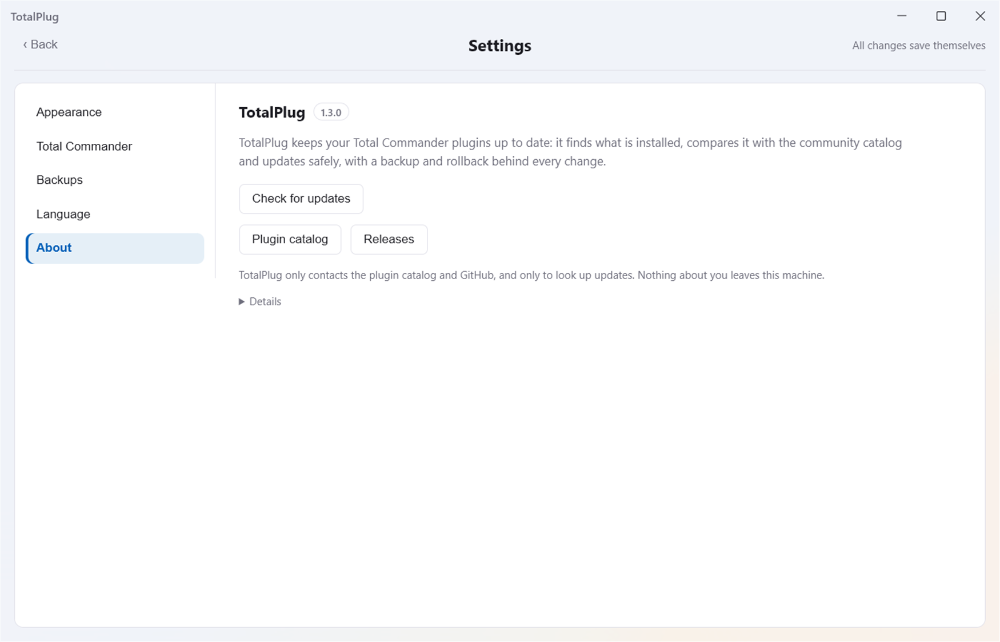
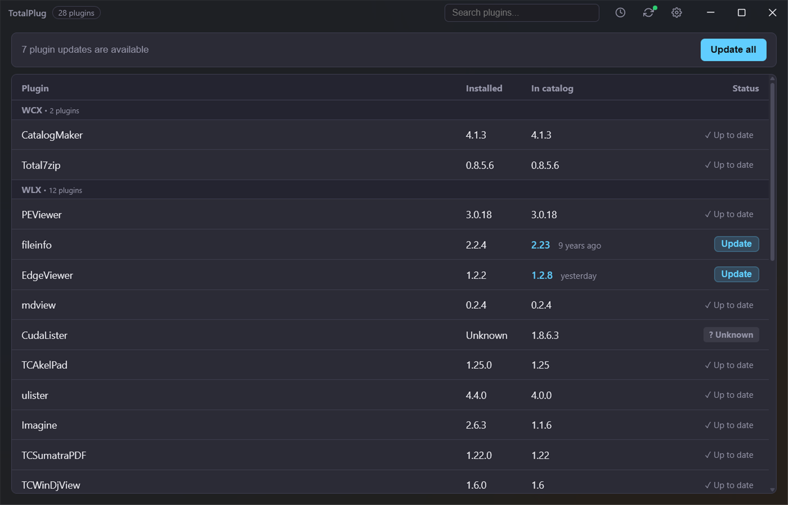
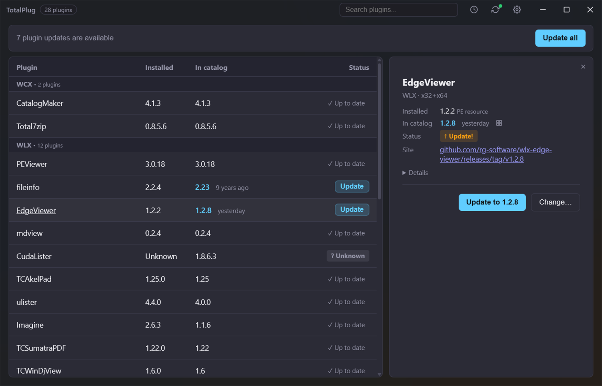
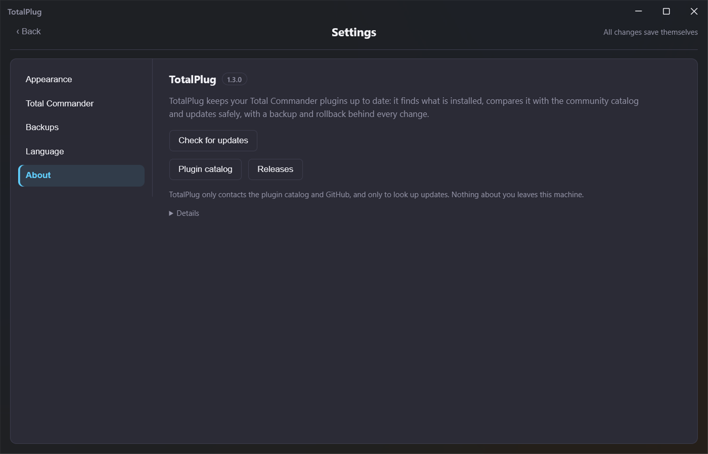

# 🚀 TotalPlug

> **Modern Total Commander Plugin Manager, Version Auditor & Updater** (`WCX`, `WLX`, `WFX`, `WDX`).

[](https://opensource.org/licenses/MIT)
[](https://goreportcard.com/report/github.com/goloveshko/totalplug)
[](https://github.com/goloveshko/totalplug-catalog)

**TotalPlug** is a fast, lightweight, and extensible utility written in Go for managing, inspecting, and keeping your Total Commander plugins up to date.

---

## 📥 Download

Prebuilt Windows x64 binaries are on the [Releases page](https://github.com/goloveshko/totalplug/releases):

- `totalplug-vX.Y.Z-win-x64.zip` — both binaries at the archive root, plus the
  license: `totalplug.exe` is the desktop GUI (Wails window, no installer, run it
  from any folder) and `totalplug-cli.exe` the command-line scanner and updater;
- `totalplug-vX.Y.Z-win-x64.zip.sha256` — the archive's checksum, in the format
  `sha256sum -c` reads.

Extract the whole folder instead of running an exe out of the archive: Windows
keeps the downloaded zip's marker and repeats the warning for every file inside
it. Both need Windows 10 or 11; the GUI renders through the WebView2 runtime that
already ships with Windows 11 and with current Windows 10 updates.

The binaries are not code-signed, so SmartScreen shows "Windows protected your
PC" on the first run — pick **More info → Run anyway**. TotalPlug writes only to
your Total Commander `plugins` directory, to its own data folder and to a
throwaway download folder it removes on exit (see **Where Your Files Live**);
before it changes a plugin folder, a copy of that folder goes into `backups\` of
the same data folder.

---

## 📁 Where Your Files Live

TotalPlug keeps its data in one folder, picked at every start:

- **Portable** — a `totalplug` folder next to the `.exe`, whenever that folder
  accepts writes. Copy the app's folder to another machine or a USB stick and the
  whole setup travels with it, WebView2 profile (theme, language, font size)
  included. On the first portable run the database, the overrides, the update
  history and the settings are copied out of `%APPDATA%\totalplug` — only the
  files this version reads, so old caches and retired files stay behind. The
  originals are left alone, so nothing is lost by trying.
- **Per-user** — `%APPDATA%\totalplug`, when the executable sits somewhere
  read-only: Program Files, a write-protected share, a mounted image.

Inside that folder the plugin database, the overrides, the update history and
the window settings sit at the top level, the downloaded catalog and GitHub
release snapshots go to `cache\`, the pre-update copies of your plugin folders go
to `backups\`, and the WebView2 profile to `webview2\`. Deleting `cache\` costs
the next download; deleting `webview2\` resets the theme, language and font size;
deleting `backups\` removes your route back to an older version, so look at
Settings → Backups first.

`backups\` is grouped by the folder Total Commander keeps each plugin in, so a
CudaLister file system plugin reads as `backups\wfx\CudaLister.bak_<unix>`. The
copies stay out of your Total Commander tree on purpose: a dead folder beside a
plugin is yours to notice and clean up by hand. Settings → Backups decides how
long they survive — the newest few are always kept, and past them a copy goes once
it is older than the day limit you set (0 days deletes nothing). The same file
holds that answer for the command line, so `--update-all` prunes by the same rule.
Versions before this one wrote the copies next to the plugin; updating a plugin
carries whatever is still there into `backups\`.

You do not need those folders to go back: the newest line in the update history
about a plugin offers to put its copy back into the plugin folder — the last change
and nothing older, so the log cannot walk you backwards through itself. The version
a rollback displaces is kept as a copy of its own, and the way forward from a
rollback is to update the plugin again.

A rollback writes the copy over the folder rather than emptying it first, so it works
with Total Commander running, exactly like an update. The files that update brought
with it are then taken out — but only those, because a plugin saves its own settings
next to its DLL and you may have put a file in that folder yourself. A history line
written before TotalPlug kept track of file names puts the copy back and removes
nothing. When Total Commander has the plugin loaded and one file cannot be replaced,
the folder is returned to the version it held and no copy of this attempt is kept:
close the window and ask for the same rollback again.

An update also needs somewhere to hold its download while it is unpacked — the
only place TotalPlug writes that is neither your plugins folder nor its own data
folder: `%TEMP%\totalplug`, with one subfolder per running instance so two copies
of the app never unpack into each other. The unpacking space goes when that update
ends. A package that unpacked all right but could not be written into the plugin
folder — Total Commander still holding it, for instance — stays beside it until the
app closes, so the retry after you close the window starts from the download it
already has instead of fetching it again. A run killed mid-way leaves a leftover
that a later start sweeps once it is over an hour old. `TOTALPLUG_SCRATCH_DIR`
moves the whole tree elsewhere.

The About panel prints the folder in use. `TOTALPLUG_DATA_DIR` pins it to any
path you choose.

---

## ✨ Key Features

- 🔍 **Zero-Config Total Commander Detection:**  
  Automatically discovers `wincmd.ini` from Windows Registry (`HKCU`/`HKLM` 32-bit & 64-bit) or `%APPDATA%`, and resolves `%COMMANDER_PATH%` / `%COMMANDER_DRIVE%`. The installation folder is recognised by the Total Commander launcher found next to the ini or one level above it — the layout a portable install uses (`<install>\ini\wincmd.ini`, with `totalcmd64.exe` on a 64-bit copy) — so pointing TotalPlug at any `wincmd.ini` scans the install it belongs to, not the one the registry happens to know. When no launcher is found around the ini, the folder is reported as unresolved instead of guessing.
- 📦 **Smart Plugin Parser & Deduplication:**  
  Extracts all Packer (`WCX`), Lister (`WLX`), File System (`WFX`), and Content (`WDX`) plugins, merging duplicate archive extensions into single logical plugins.
- 🧬 **5-Tier Version Extraction Engine:**
    1. **Tier 1 (PE Binary Resources):** Reads exact `VS_FIXEDFILEINFO` and `StringFileInfo` via Windows API `version.dll`.
    2. **Tier 2 (Companion DLLs):** Inspects companion libraries (e.g. `MediaInfo64.dll`) if the wrapper lacks metadata.
    3. **Tier 3 (pluginst.inf):** Reads the `version=` key the plugin declares in its own `pluginst.inf` — a structured field, so it is trusted like a binary version.
    4. **Tier 4 (Docs / INF Scanner):** Extracts version strings from `readme.txt` and `history.txt`. A number found in prose is not trusted for the update decision on its own: the row is reported as uncertain and can be applied by hand.
    5. **Tier 5 (Confidence Tags):** Transparently labels confidence (`[PE Binary]`, `[Pluginst.inf]`, `[Readme/INF]`, `[Manual DB]`, `[Unknown]`).
- 🌐 **Powered by TotalPlug Community Catalog:**  
  Checks updates against the open [totalplug-catalog](https://github.com/goloveshko/totalplug-catalog) database. The on-disk copy is revalidated by ETag on every launch — a newly published plugin shows up on the next start, an unchanged catalog costs a 304 instead of a full download — and it is what answers when the network does not.
- 🔁 **Mirror Search on a Dead Download Link:**  
  A totalcmd.net download counter sometimes redirects to a host that no longer answers. When
  every catalog source fails, TotalPlug reads that plugin's current page and its linked
  `wincmd.ru` counterpart from your own machine. The counterpart must advertise the exact
  requested version before its main download is tried; the archive's redirects must stay on
  trusted HTTPS hosts (`wincmd.ru` and its subdomains). Both legacy `download.php?id=` links
  and current `/download/<id>/main` links are supported. Nothing is scraped in advance: pages
  are fetched only for actually broken downloads. When no usable mirror is found, the update
  fails with the plugin's web address in the message.
- 🗜️ **Archive-Format Aware Updater:**  
  Plugin packages are dispatched by their magic bytes, so ZIP, RAR and 7z all
  install, while an unsupported container is refused with a clear message
  instead of a half-extracted folder.
- 💾 **User Overrides & Database:**  
  Persist custom names, versions, and update sources in `user_overrides.json`,
  inside the data folder TotalPlug picks for you.
- 🖥️ **Dual Interface:**  
  High-speed command-line interface (CLI) and hybrid desktop GUI powered by **Wails v2**.

---

## 🖥️ Desktop GUI

`totalplug.exe` shows the same audit the CLI prints as a table you can act on:

- **Update all** — a bar above the table appears whenever updates are available
  and applies the whole list in one pass, one plugin at a time. Plugins whose
  installed version could not be determined stay out of the batch, exactly like
  `--update-all` on the command line.
- **Per-plugin update** — the button in the row, for the cases a batch skips.
- **Plugin card** — click a row for the description, update source, homepage and
  install path, plus an editor for a manual version/source override when
  auto-detection got it wrong.
- **History** — the updates TotalPlug applied, with version and timestamp, grouped by
  plugin: the newest change leads each group and the earlier ones open behind it.
- **Settings** — light/dark/system theme, English/Russian interface, font size,
  and a Total Commander panel that names the `wincmd.ini` the next scan reads:
  auto-detected, or one you pick when the registry does not know your install.
- **Remembered window** — the size, position and maximised state you closed with
  are what the next launch opens with; only the very first run starts at the
  default 1024×768.
- **About** — the running version, where your data lives, and a check for a newer
  release. TotalPlug never replaces its own files: it opens the release page.

You do not have to close Total Commander to apply an update: every file is put in
place by renaming a fresh copy over it, and a loaded plugin allows that. Closing it
is what to do when a file refuses anyway — the queue stops at the first locked file
and skips the rest, so a run with Total Commander closed finishes the list.

---

## 📸 Screenshots

The same window in both themes, with a scanned install of 28 plugins. The window is
wide enough for the plugin card to stand beside the table instead of over it.

### Light

| Main window                                                                                                                                                                                                                                                                                                                        | Plugin card                                                                                                                                                                                                                                                                                                                                                                      | About                                                                                                                                                                                                      |
| ---------------------------------------------------------------------------------------------------------------------------------------------------------------------------------------------------------------------------------------------------------------------------------------------------------------------------------- | -------------------------------------------------------------------------------------------------------------------------------------------------------------------------------------------------------------------------------------------------------------------------------------------------------------------------------------------------------------------------------- | ---------------------------------------------------------------------------------------------------------------------------------------------------------------------------------------------------------- |
|  |  |  |

### Dark

| Main window                                                                                                                 | Plugin card                                                                                                                                          | About                                                            |
| --------------------------------------------------------------------------------------------------------------------------- | ---------------------------------------------------------------------------------------------------------------------------------------------------- | ---------------------------------------------------------------- |
|  |  |  |

---

## 🚀 Quick Start (CLI)

### Run from Source

```bash
go run cmd/totalplug/main.go
```

### Force Refresh Catalog Cache

```bash
go run cmd/totalplug/main.go --refresh-cache
```

### Apply Available Updates

Interactive mode — lists pending updates and asks for confirmation:

```bash
go run cmd/totalplug/main.go --update
```

Non-interactive mode — applies every available update without prompting (for scripts and Task Scheduler):

```bash
go run cmd/totalplug/main.go --update-all
```

> Closing Total Commander is not needed for most updates: a file is replaced by renaming a fresh
> copy over it, and Total Commander keeps a plugin loaded only while it uses one. Close it and run
> again when a plugin still reports as locked — that is the loaded file holding the rename back,
> and the queue stops there and skips the rest.
> Updates are safe by design: the plugin folder is copied first to `backups\<type>\<dir>.bak_<unix>`
> in the TotalPlug data folder, and any mid-apply failure is automatically rolled back to the
> previous state.
> Plugins whose installed version cannot be determined are never auto-updated: in `--update` they
> are offered separately with a per-item `[y]es / [N]o / [a]ll` prompt, and `--update-all` skips them.

### Exit Codes

The command line answers a script with a code, not only with text:

| Code | Meaning                                                                                                 |
| ---- | ------------------------------------------------------------------------------------------------------- |
| `0`  | done, or there was nothing to do                                                                        |
| `1`  | an update or a rollback failed (or an update went through but could not be written to the history file) |
| `2`  | the command line was not understood                                                                     |
| `3`  | Total Commander or its `wincmd.ini` was not found                                                       |

`--help` prints the flags and these codes.

Only one run works on a data folder at a time: the window and the command line
both take the same lock, so a scheduled task and a manual run cannot replace the
same plugin folder at the same moment.

### Read the Update Log and Undo an Update

```bash
go run cmd/totalplug/main.go --history
go run cmd/totalplug/main.go --rollback CudaLister
```

Neither scans Total Commander and neither goes online: both read the log
`--update` writes, so they answer straight away. `--history` lists the changes
newest first and marks the line a rollback can still use. `--rollback` takes a
catalog id or a plugin name (compared without case), shows the folder, the
version it goes back to and the copy it puts there, and asks before writing.

The same rule the History panel follows holds here: only the last change to a
plugin is rolled back, and a rollback line is not itself rolled back — after
one, the way forward is `--update`.

### Point to a Portable Total Commander Install

```bash
go run cmd/totalplug/main.go --ini D:\TC\wincmd.ini
```

### Check Which Build You Have

```bash
go run cmd/totalplug/main.go --version
```

Prints the version stamped at build time — the same value the GUI shows on its
About panel, which drops the trailing `.0` of a four-part stamp. `go run` passes
no `-ldflags`, so this command reports the unstamped `dev` even in a tagged tree;
use `scripts\build.cmd` for a numbered binary.

### Example Output

```text
================================================================================
                     TotalPlug - Total Commander Updater
================================================================================
[+] Scanning Total Commander plugins...
[+] Total Commander Dir: C:\totalcmd
[+] Found wincmd.ini:    C:\totalcmd\wincmd.ini
[+] Fetched fresh catalog from GitHub CDN!

Discovered 14 installed plugins:

--- [WCX] Packer / Archiver Plugins (WCX) (4) ---
 1. Total7zip          ✓  | Ver: 1.3.5      | [PE Binary]    ➔ Latest: 1.3.5
 2. PAXZ Archiver      ⚠️ | Ver: 1.0.0      | [Readme/INF]   ➔ Latest: 1.0.0

--- [WLX] Lister / Viewer Plugins (WLX) (5) ---
 3. CudaLister         ✓  | Ver: 1.8.6.1    | [PE Binary]    ➔ Latest: 1.8.6.1
 4. MDView             🚀 | Ver: 1.2.0      | [PE Binary]    ➔ Latest: 1.2.5

================================================================================
SUMMARY: Total 14 | 13 Valid ✓ | 1 Updates 🚀 | 0 Missing ✗ | 1 Uncertain ⚠️
================================================================================
--------------------------------------------------------------------------------
LEGEND:
  ✓  - Up to date
  🚀 - Update available
  ⚠️ - Uncertain version (check manually or force update)
  ✗  - Plugin file missing on disk

[🚀] SUCCESS: Found 1 plugin update(s) available!
```

---

## 🔨 Build from source

Requirements: Go 1.25+, Node 22+, and for the GUI the Wails v2 CLI
(`go install github.com/wailsapp/wails/v2/cmd/wails@v2.14.0`).

The module is `github.com/goloveshko/totalplug`, so the CLI alone needs no clone:
`go install github.com/goloveshko/totalplug/cmd/totalplug@latest`. The GUI cannot be
installed that way — it embeds `frontend/dist`, which is build output and stays out
of the repository — so it is built with the scripts below.

| Command                                          | Result                                                                      |
| ------------------------------------------------ | --------------------------------------------------------------------------- |
| `scripts\build.cmd`                              | `bin\totalplug-cli.exe`, development build                                  |
| `scripts\build-gui.cmd`                          | `bin\totalplug.exe` (also accepts extra `wails` flags, e.g. `-devtools`)    |
| `scripts\release.cmd`, `scripts\release-gui.cmd` | Same, with `-trimpath` and stripped symbols                                 |
| `scripts\package.cmd`                            | Release builds of both, zipped for a GitHub release, plus its `.sha256`     |
| `scripts\run.cmd`                                | Runs the CLI from source (`go run ./cmd/totalplug`), arguments pass through |
| `scripts\test.cmd`                               | `go test -v ./...`, extra arguments pass through to `go test`               |
| `scripts\lint.cmd`                               | `go vet ./...`, plus `golangci-lint` when it is installed                   |
| `npm run format` (in `frontend\`)                | Prettier over the repo; `format:check` only reports, and is what CI runs    |

Tagged builds are stamped with `git describe --tags --dirty` through `-ldflags
-X`, which is the version the About panel shows and the release check compares
against; before the first tag exists the build scripts fall back to the version
tracked in `wails.json`, so an untagged tree compares too. Only a binary built by
hand — a bare `go build`, or the `go install` above — carries no stamp (`dev`) and is
never told an update exists.
Publishing a version (tag → build → release assets) is a documented procedure:
see [docs/release.md](docs/release.md).

---

## 🏗️ Architecture & Project Structure

```text
totalplug/
├── cmd/totalplug/main.go     # CLI entry point: report, --update / --update-all prompts
├── cmd/totalplug/history.go  # CLI over the update log: --history, --rollback
├── main.go                   # GUI entry point: embeds frontend/dist, hands it to gui.Run
├── internal/
│   ├── buildinfo/            # Version stamped at build time, release location
│   ├── checker/              # Catalog client + disk cache, version compare, GitHub releases
│   ├── config/               # Registry & wincmd.ini resolution, data folder layout
│   ├── domain/               # Shared models (Plugin, Status, Confidence, AppInfo)
│   ├── gui/                  # Wails bridge — the Go methods the frontend may call, window state
│   ├── pipeline/             # Scan orchestration: detect → read → compare
│   ├── rollback/             # Which history line may still go back, for the GUI and the CLI
│   ├── scanner/              # Plugin discovery, PE / INF version extraction
│   ├── storage/              # installed_plugins.json, user overrides, update history
│   └── updater/              # Download, archive extract, backup, lock-aware install
├── frontend/                 # Wails GUI: Svelte islands over plain HTML/CSS/JS, built by Vite
├── scripts/                  # build.ps1 plus the .cmd wrappers listed above
└── wails.json
```

---

## 🤝 Community Catalog

TotalPlug relies on the open community registry [totalplug-catalog](https://github.com/goloveshko/totalplug-catalog). Anyone can add or update plugins by submitting a simple Pull Request!

The catalog holds one download address per plugin and deliberately no mirror list: a catalog of
~1200 entries would have to be built by scraping ~1200 plugin pages on every run, so the fallback
copy is looked up at update time instead, from your machine, and only for the plugin whose
download just failed.

---

## ⚖️ License

Distributed under the [MIT License](LICENSE).

---

## 👨‍💻 Author & Support

Developed with ❤️ by [Sergey Goloveshko](https://sergey.is-a.dev) — **AI & Systems Engineer**.

- **Portfolio**: [sergey.is-a.dev](https://sergey.is-a.dev)
- **Telegram Support**: [@itz2bot](https://t.me/itz2bot?start=totalplug_readme)
- **Report an Issue**: [GitHub Issues](https://github.com/goloveshko/totalplug/issues)
